# MGM Laboratory website

The website and CMS of MGM Laboratory, the Media, Game and Mobile laboratory at the Faculty of Computer Science (FILKOM), Universitas Brawijaya, in Malang, Indonesia. It presents the lab, its members, projects, publications, articles, events and open positions. The lab team manages that content in a built-in `/admin` workspace. The project is maintained by the owner and deployed on MGM infrastructure.

[](https://github.com/MGM-Laboratory/mgm-website/actions/workflows/ci.yaml)
[](https://github.com/MGM-Laboratory/mgm-website/actions/workflows/security.yaml)
[](https://github.com/MGM-Laboratory/mgm-website/actions/workflows/e2e.yaml)
[](https://github.com/MGM-Laboratory/mgm-website/actions/workflows/lighthouse.yaml)
[](https://github.com/MGM-Laboratory/mgm-website/actions/workflows/vale.yaml)
[](https://github.com/MGM-Laboratory/mgm-website/actions/workflows/docker.yaml)
[](https://codecov.io/gh/MGM-Laboratory/mgm-website)
[](https://securityscorecards.dev/viewer/?uri=github.com/MGM-Laboratory/mgm-website)
[](https://results.pre-commit.ci/latest/github/MGM-Laboratory/mgm-website/main)

[](https://nextjs.org)
[](https://www.typescriptlang.org)
[](https://tailwindcss.com)
[](https://nodejs.org)
[](https://turbo.build)
[](https://nestjs.com)

[](https://github.com/MGM-Laboratory/mgm-website/commits/main)
[](https://github.com/MGM-Laboratory/mgm-website)

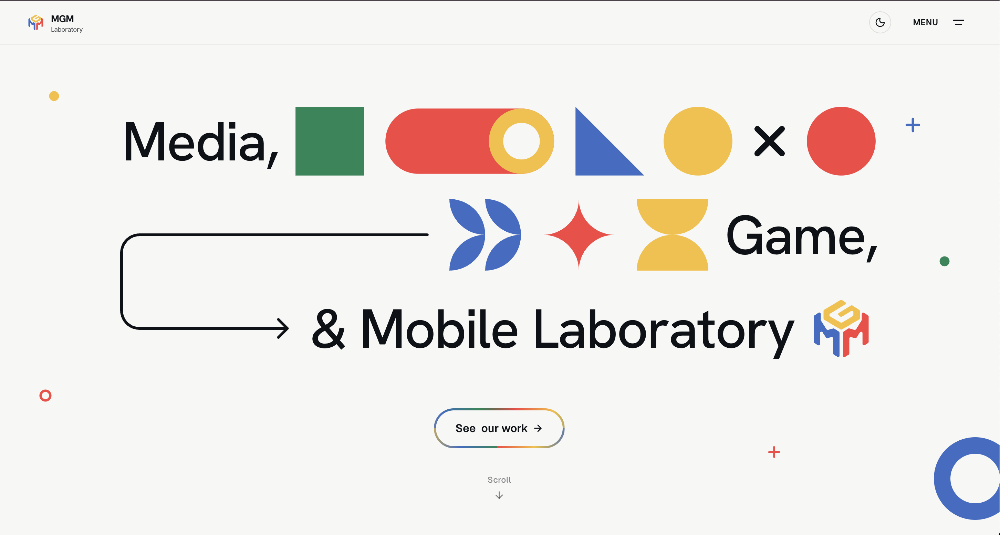
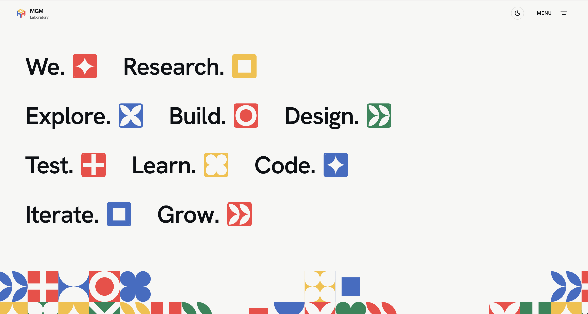
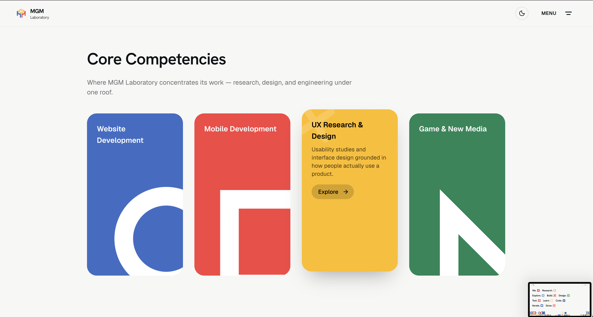
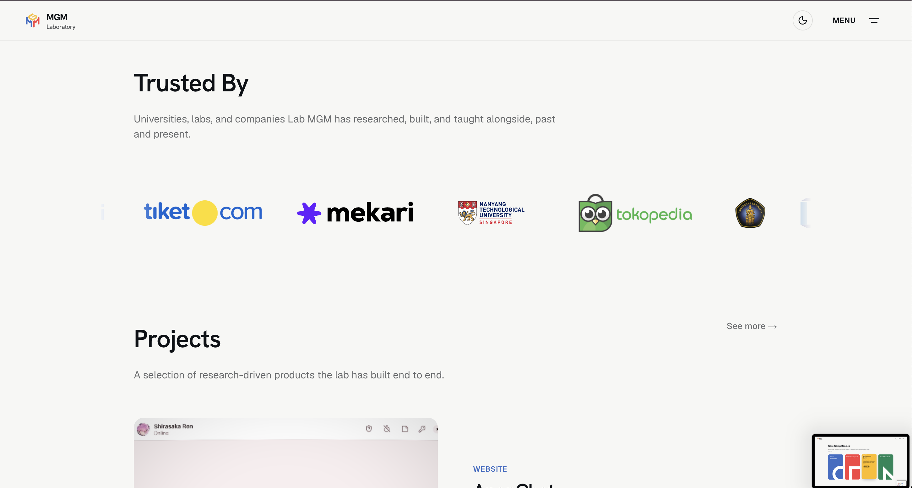
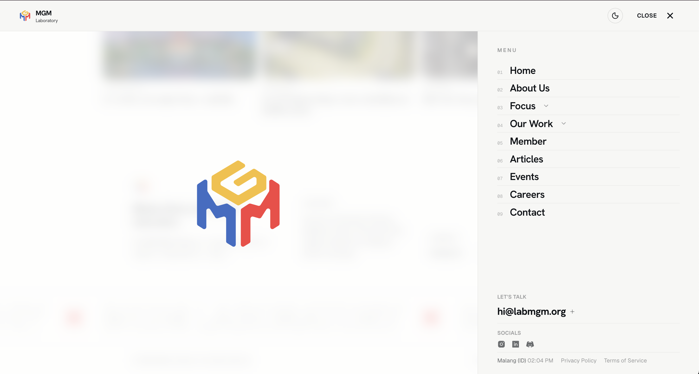
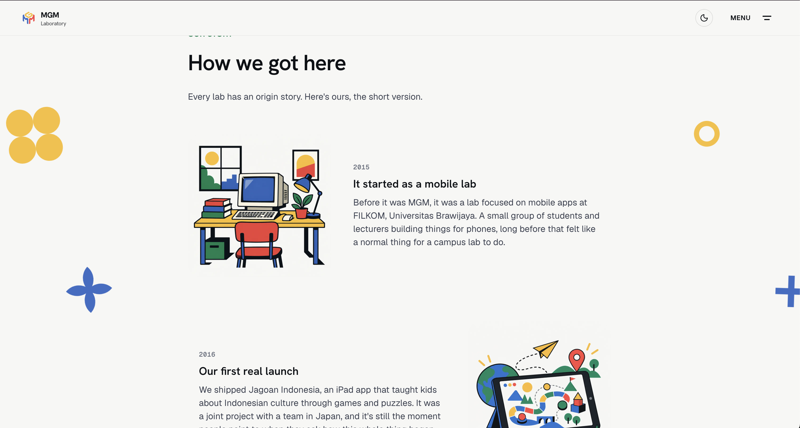
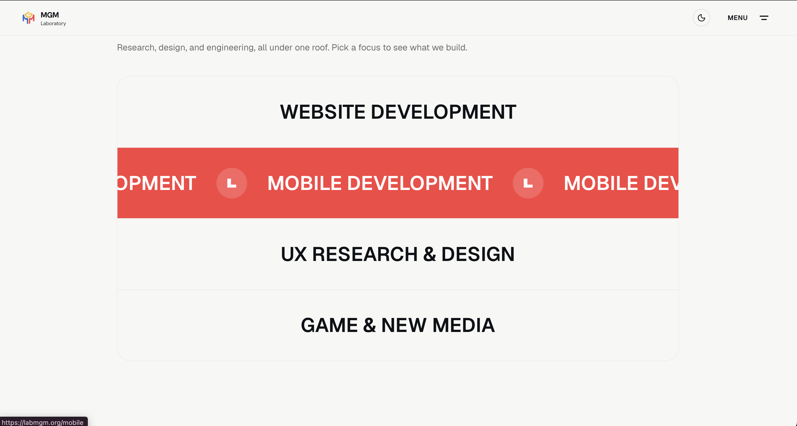
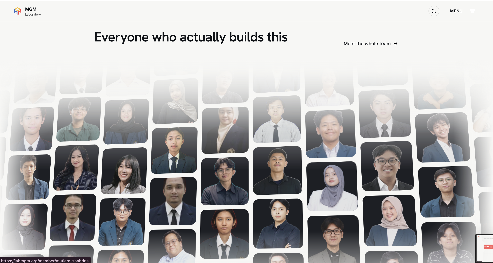
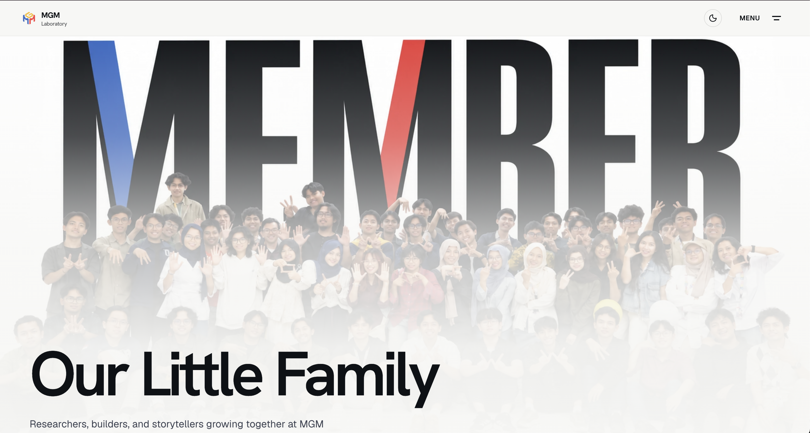
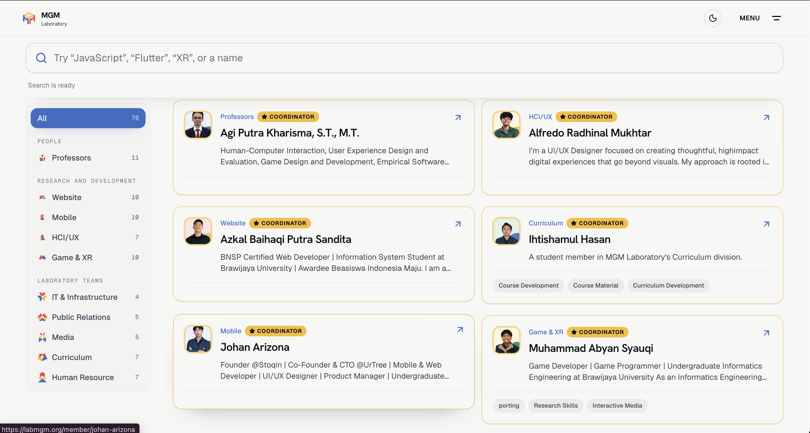
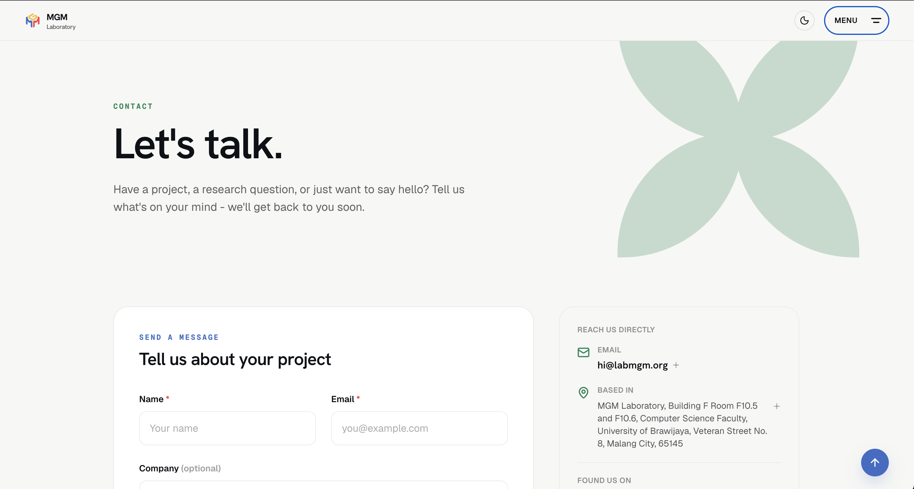

## Status

| Site                   | Uptime                                                                                                                                                                                                                                                                                                      |
| ---------------------- | ----------------------------------------------------------------------------------------------------------------------------------------------------------------------------------------------------------------------------------------------------------------------------------------------------------- |
| Website (`labmgm.org`) | [](https://status.labmgm.org/endpoints/core_mgm-website) [](https://status.labmgm.org/endpoints/core_mgm-website) |

Status page: [status.labmgm.org](https://status.labmgm.org)

## Stack

- Web in `apps/web`. The site and the `/admin` workspace, built with Next.js 16 (App Router), React 19, Tailwind CSS 4, GSAP and WebGL.
- API in `apps/api`. NestJS 12, Prisma 7 and PostgreSQL. Mail goes through Resend, SMTP or AWS SES. Uploads go to an S3 compatible store.
- Shared code in `packages/shared`.
- pnpm 11 workspaces and Turborepo on Node 22.
- CI on GitHub Actions. CI builds the Docker images and publishes them to GitHub Container Registry and Docker Hub.

## Quick start

Requires Node 22 and pnpm 11.3.0.

```bash
pnpm install
cp apps/api/.env.example apps/api/.env
cp apps/web/.env.example apps/web/.env
```

The API needs a reachable PostgreSQL with an empty `mgm_website` database. Put its password in the `DATABASE_URL` of `apps/api/.env`, or copy `.env.example` to `.env`, set `POSTGRES_PASSWORD`, run `docker compose up postgres` and use that password. Set `ADMIN_PASSPHRASE` in `apps/api/.env` and the same value in `apps/web/.env`. Create the passphrase with `openssl rand -hex 64`. Then start the two servers in separate terminals.

```bash
pnpm dev:web # http://localhost:3000
pnpm dev:api # http://localhost:4000
```

To run Postgres, the API and the web app together, copy `.env.example` to `.env`, set `POSTGRES_PASSWORD`, `ADMIN_PASSPHRASE` and `SESSION_SECRET`, and run `docker compose up`.

## Configuration

Every setting is an environment variable. The API refuses to start when a required one is missing. Each workspace has a `.env.example` with the names.

| Setting               | Default                               | Purpose                                                                                                  |
| --------------------- | ------------------------------------- | -------------------------------------------------------------------------------------------------------- |
| `DATABASE_URL`        | none, required                        | The PostgreSQL connection string.                                                                        |
| `ADMIN_PASSPHRASE`    | none, required                        | The superadmin passphrase. The API and the web app need the same value.                                  |
| `SESSION_SECRET`      | none, required, 32 characters or more | The key of the admin session and of the form unlock tokens. The API and the web app need the same value. |
| `CORS_ORIGIN`         | `http://localhost:3000`               | The origins that may call the API from a browser.                                                        |
| `NEXT_PUBLIC_API_URL` | `http://localhost:4000/api`           | The API address that browsers call. It is set when the web image is built.                               |
| `AWS_S3_BUCKET`       | none                                  | The bucket for uploads. Without it, uploads do not work.                                                 |

[`docs/configuration.md`](docs/configuration.md) lists every setting.

## Documentation

The reading order and the full index are in [`docs/README.md`](docs/README.md). The main pages are below.

- [`DESIGN_SYSTEM.md`](DESIGN_SYSTEM.md) is the design source of truth.
- [`docs/architecture.md`](docs/architecture.md) describes the monorepo layout and the routing.
- [`docs/cms-admin.md`](docs/cms-admin.md) describes the CMS and the `/admin` workspace.
- [`docs/configuration.md`](docs/configuration.md) lists every setting.
- [`docs/ci-cd.md`](docs/ci-cd.md) lists the workflows and the required checks.
- [`docs/deployment.md`](docs/deployment.md) explains how to run the Docker images on a host and how to update them.

## Project layout

```text
apps/web/              Next.js site and the /admin workspace
apps/api/              NestJS API (cms, contact, forms, mail, shortlinks, storage)
packages/shared/       Shared workspace package
docs/                  Documentation
.github/workflows/     CI workflows
```

## Contributing and security

Read [`CONTRIBUTING.md`](CONTRIBUTING.md) for the branch, commit and pull request rules and for the required checks. Report a security issue as [`SECURITY.md`](SECURITY.md) describes, and not in a public issue.

## License

GNU General Public License v3.0. See [`LICENSE`](LICENSE).
